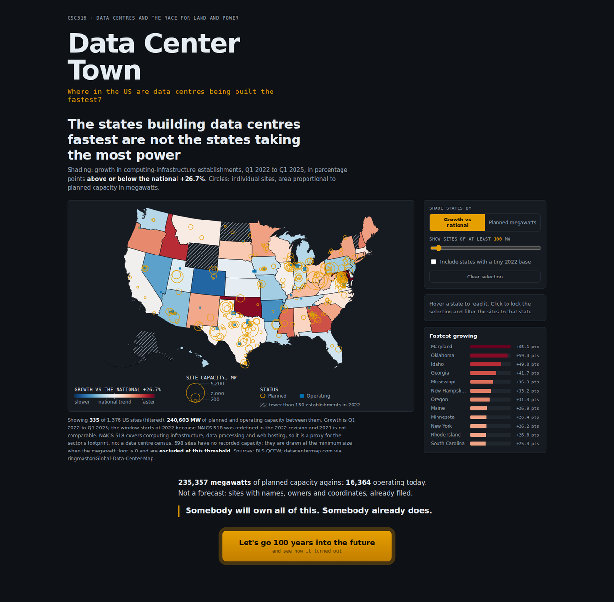
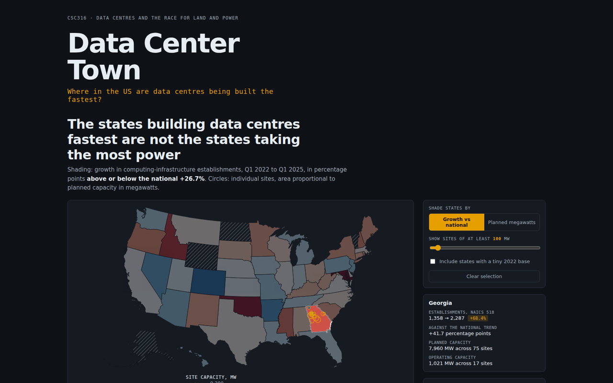
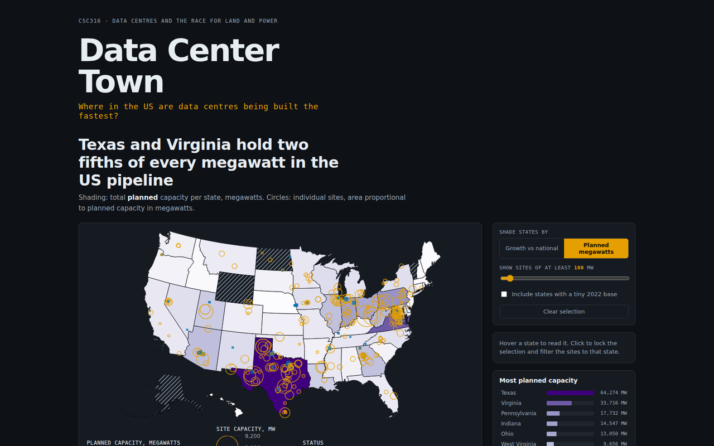
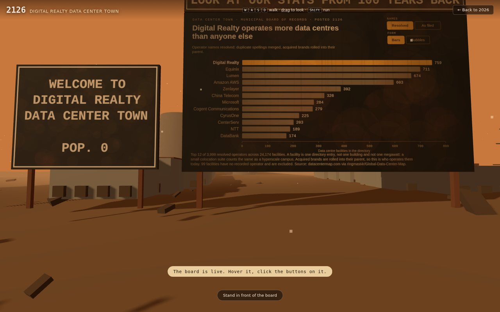
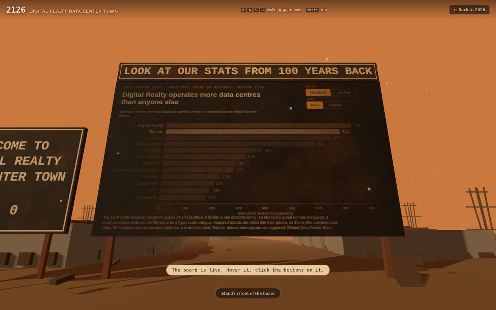
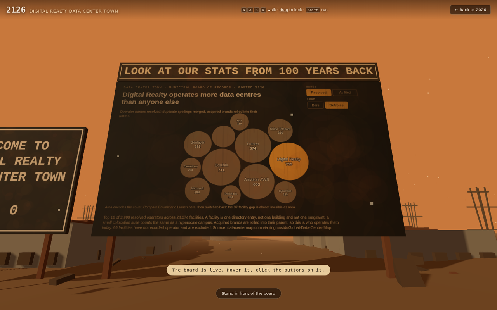

# Data Center Town

**Live site: https://titanicsteak.github.io/316-project/**

CSC316 group project, Milestone 7 (Prototype V1).
**Team:** Owen Lo, Evan White, Kaiyang Chang, Iftekhar Khaled.

Where data centres are being built fastest in the US, and who ends up owning
the place. A start screen with the first chart on it, then a hundred-year jump
into the company town that got built, where the second chart hangs on a
billboard you read and operate in the world.

```
screen 1   D3        "Where in the US are data centers being built the fastest?"
   |                  choropleth of growth + site dots sized by megawatts
   |         [ Let's go 100 years into the future ]
   v
screen 2   three.js   a company town, a hundred years on
                      two boards side by side: a welcome sign, and
           D3         "Which companies have the most data centers?"
                      read and operated ON the board, in the world
```

---

## Screenshot tour

### 1. The start screen

The question, the map, and a button. Hover a state to read it, click to lock
the selection and filter the sites to it, drag the megawatt floor to walk down
the long tail, or switch what the shading encodes.



### 2. Selecting a state

Clicking a state is a filter, not a highlight: the dots recompute and the
caption recounts, so the chart never claims to be showing more than it is.



### 3. Re-encoding to planned megawatts

The same map, shaded by planned capacity instead of growth. This is the
finding: the fastest-growing states are *not* the states taking the most
power. Georgia is the only one high on both.



### 4. A hundred years later

Press the button and the sky warms from near-black to dust orange while the
year counter runs 2026 to 2126. You land at the edge of a company town named
after whoever won the second chart.



### 5. The billboard is the chart

Not a picture of one, and not a door to an overlay. Hover a bar out in the
world and the others dim out in the world. The buttons painted on the board
are real buttons.



### 6. The original sketch, kept for the comparison

Switching to bubbles is the argument for bars: Equinix at 711 and Lumen at 674
are nearly indistinguishable as area.



---

## Setup

**Requirements:** Python 3.8+ for the pipeline and the dev server
(`pandas` only for the cleaning scripts), plus `git` and `curl`. No Node, no
npm, no build step. `d3`, `topojson-client` and `three` are vendored into
`web/vendor/`.

### Just run the site

`data/processed/` and `web/data/` are committed, so this is enough:

```bash
git clone https://github.com/titanicsteak/316-project
cd 316-project
make serve                      # http://localhost:8316
```

A server is required. The charts `fetch` their CSVs, and `file://` blocks
that, so opening `web/index.html` directly will give you an empty page.

Without `make`:

```bash
cd web && python3 -m http.server 8316
```

### Rebuild the data from source

```bash
pip install pandas              # only needed for this part
bash scripts/01_fetch_raw.sh    # downloads every raw source (needs network)
make data                       # cleans and reshapes them
cp data/processed/us_state_growth.csv \
   data/processed/us_pipeline_sites.csv \
   data/processed/companies_top25.csv \
   data/processed/companies_merge_audit.csv \
   data/processed/us_growth_meta.json  web/data/
```

Each stage prints its own counts, and `data/processed/cleaning_log.json`
records every row dropped and why.

### Deploy

Pushing to `main` publishes `web/` to GitHub Pages through
`.github/workflows/pages.yml`. One-time repo setup:
**Settings → Pages → Source → GitHub Actions**.

---

## How to read it

1. Hover states on the map; click one to lock it
2. Drag the megawatt slider to about 1000 to watch the long tail drop away
3. Switch **Shade states by** to *Planned megawatts* — the story changes
4. Tick *Include states with a tiny 2022 base* to let the hatched states in
5. **Let's go 100 years into the future**
6. `W` `A` `S` `D` to walk, `Shift` to run, drag to look
7. Walk up to the right-hand board and hover the bars on it
8. Click **As filed** on the board and watch Amazon jump to the top

---

## Layout

| path | what |
|---|---|
| `scripts/` | the data pipeline, four stages, re-runnable |
| `data/raw/` | sources exactly as downloaded, never edited |
| `data/processed/` | the tidy tables the charts load |
| `data/README.md` | sources, every cleaning decision, the output schemas |
| `web/` | the site |
| `web/README.md` | design decisions against the course critique checklist |
| `docs/img/` | the screenshots above |

---

## The two built visualisations

**Viz 1 · "Where in the US are data centers being built the fastest?"**

State choropleth of growth in computing-infrastructure establishments against
the national trend, with 1,376 planned and operating sites drawn at their real
coordinates and sized by capacity. **235,357 MW** of planned capacity against
**16,364 MW** operating today.

The finding: the fastest-growing states are not the states taking the most
power. Maryland, Oklahoma and Idaho are adding businesses fastest; the
megawatts are going to Texas and Virginia, which were already the biggest.
Georgia is the only state near the top of both lists.

**Viz 2 · "Which companies have the most data centers?"**

24,174 facilities resolved from 4,079 raw operator spellings down to 3,999
operators, with a full merge audit trail.

The finding: on the raw names Amazon AWS leads with 539. Once duplicate
spellings merge (`Amazon` + `Amazon AWS`) and acquired brands roll into their
parents (`CenturyLink` → Lumen, `Interxion` → Digital Realty), Amazon drops to
fourth and three colocation landlords nobody has heard of come out ahead of
the cloud brands.

| | raw spellings | resolved |
|---|---|---|
| 1 | Amazon AWS 539 | **Digital Realty 759** |
| 2 | Equinix 705 | Equinix 711 |
| 3 | Lumen 444 | Lumen 674 |
| 4 | Digital Realty Trust 330 | Amazon AWS 603 |

---

## Two things the data forced

**The raw source is two datasets stuck together.** 24,258 global directory
records with city-level coordinates and no dates, plus 1,499 US pipeline
records with real coordinates, build status and capacity in MW. 115 facilities
appear in both. They stay in separate files and each chart uses the one that
fits its question.

**"Fastest" needed a rate, and NAICS 518 changed definition in 2022.** A map of
where data centres *are* cannot answer "fastest", so growth comes from BLS QCEW
establishment counts. But NAICS 518 was redefined in the 2022 NAICS revision,
and the national count jumps 27% in that single year from reclassification
alone. The growth window therefore starts at **Q1 2022**, the first year on the
current definition. Using 2021 would have put Maryland at +234% growth, most of
it an accounting change.

Full detail in [`data/README.md`](data/README.md).

---

## Sources

- [ringmast4r/Global-Data-Center-Map](https://github.com/ringmast4r/Global-Data-Center-Map), scraped from [datacentermap.com](https://www.datacentermap.com/datacenters/)
- [BLS QCEW](https://data.bls.gov/cew/apps/data_views/data_views.htm), NAICS 518
- [Our World in Data / IEA](https://ourworldindata.org/grapher/data-centers-share-electricity-demand)
- [us-atlas](https://github.com/topojson/us-atlas) for the state boundaries
